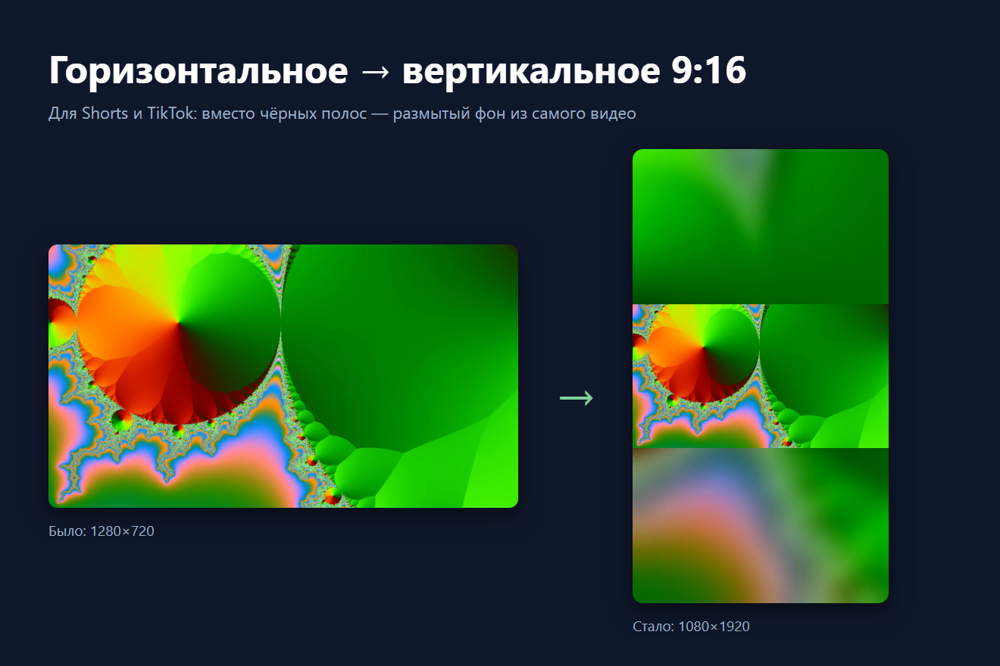
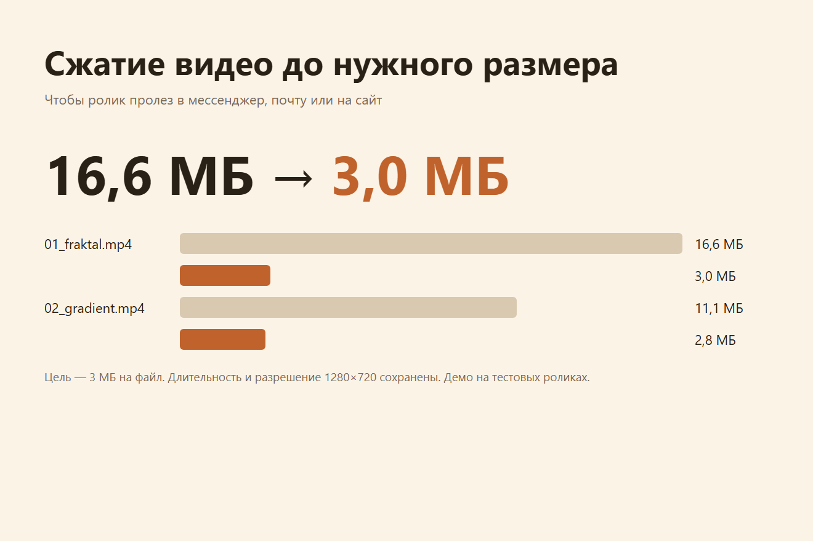

# Пакетная обработка видео одним скриптом

## Как выглядит результат





Скрипт на Python, который берёт **все ролики из папки `input`**, обрабатывает их и кладёт результат в папку **`output`**.
Не нужно открывать видеоредактор и делать одно и то же с каждым файлом вручную — один запуск обрабатывает хоть 5, хоть 500 роликов.

## Что умеет (простыми словами)

| Режим | Что делает | Зачем нужно |
|---|---|---|
| `compress` | Сжимает видео до нужного размера в МБ (например, «не больше 8 МБ») или до заданного качества | Отправить ролик в Telegram/WhatsApp/почту, не упираясь в лимиты |
| `cut` | Режет ролик на куски: по вашему списку отрезков («с 0:05 до 0:09 — главное») или на равные части по N секунд | Нарезка для соцсетей, сторис, превью |
| `vertical` | Делает вертикальное видео 9:16 (1080×1920) для Reels, Shorts, TikTok. Вместо чёрных полос — размытая копия самого видео на фоне | Перезалить горизонтальное видео в вертикальные соцсети без «уродливых» полос |
| `audio` | Вытаскивает звук в mp3 | Подкасты, музыка, расшифровка речи |
| `concat` | Склеивает несколько роликов в один. Ролики могут быть разного размера, некоторые — без звука | Собрать один ролик из нескольких кусков |
| `watermark` | Добавляет текстовый водяной знак (например, `@my_channel`), русские буквы поддерживаются | Защитить свой контент, подписать ролики |

Для каждого запуска:

- виден **прогресс** по каждому файлу;
- в конце печатается **таблица «файл — было МБ — стало МБ»**;
- если какой-то файл повреждён, он помечается как ошибка, а **остальные всё равно обрабатываются**.

Пример итоговой таблицы (режим `compress --target-mb 2`):

```
+---------------+----------+-----------+-----------+-----------------------------------------------+
| Файл          | Было, МБ | Стало, МБ | Изменение | Результат                                     |
+---------------+----------+-----------+-----------+-----------------------------------------------+
| 01_intro.mp4  |     8.86 |      1.92 |      -78% | 01_intro_compressed.mp4                       |
| 02_main.mp4   |    11.07 |      1.94 |      -82% | 02_main_compressed.mp4                        |
| 03_final.mp4  |    13.28 |      1.92 |      -86% | 03_final_compressed.mp4                       |
| 99_broken.mp4 |     0.00 |         — |         — | файл не читается (повреждён или это не видео) |
+---------------+----------+-----------+-----------+-----------------------------------------------+
Успешно: 3 из 4. Время: 9.0 с.
```

## Что нужно установить

1. **Python 3.8 или новее** — https://www.python.org/downloads/ . При установке на Windows поставьте галочку **«Add python.exe to PATH»**.
2. **ffmpeg** — бесплатная программа, которая и делает всю работу с видео. Сторонние Python-библиотеки **не нужны**.

### Как установить ffmpeg на Windows

**Вариант 1 — одной командой (Windows 10/11).** Откройте «Терминал» или PowerShell и выполните:

```
winget install Gyan.FFmpeg
```

Закройте и заново откройте окно терминала.

**Вариант 2 — вручную.**

1. Скачайте архив `ffmpeg-release-essentials.zip` со страницы https://www.gyan.dev/ffmpeg/builds/
2. Распакуйте, например, в `C:\ffmpeg` (внутри должна быть папка `C:\ffmpeg\bin` с файлами `ffmpeg.exe` и `ffprobe.exe`).
3. Пуск → «Изменение системных переменных среды» → «Переменные среды» → в списке «Path» нажмите «Изменить» → «Создать» → впишите `C:\ffmpeg\bin` → OK.
4. Откройте **новое** окно терминала.

**Проверка:** команда ниже должна вывести версию, а не ошибку.

```
ffmpeg -version
```

## Как запустить — по шагам

1. Скачайте/распакуйте папку проекта, например в `C:\video-obrabotka`.
2. Откройте терминал в этой папке (в Проводнике: правый клик по пустому месту в папке → «Открыть в терминале»).
3. Положите свои ролики в папку `input`. Хотите сначала попробовать — создайте тестовые ролики:
   ```
   python make_test_videos.py
   ```
   Появятся три ролика 1280×720 длиной 12, 15 и 18 секунд с тестовой картинкой и звуком.
   С флагом `--with-broken` дополнительно создаётся «битый» файл, чтобы увидеть, что ошибка в одном файле не мешает остальным.
4. Запустите нужный режим, например:
   ```
   python video_tool.py vertical
   ```
5. Заберите результат из папки `output`.

Справка по всем режимам: `python video_tool.py --help`, по конкретному режиму: `python video_tool.py compress --help`.

## Примеры команд

### Сжать

```
python video_tool.py compress --target-mb 8              # каждый файл — не больше ~8 МБ
python video_tool.py compress --target-mb 15 --height 720 # заодно уменьшить до 720p
python video_tool.py compress --crf 28                    # по качеству: 18 — почти без потерь, 32 — сильно сжато
```

Режим `--target-mb` кодирует в два прохода, чтобы точно попасть в размер. Если файл уже меньше цели, он просто копируется.
Если цель нереально мала для длины ролика, скрипт скажет, сколько МБ нужно минимум.

### Нарезать

```
python video_tool.py cut --every 5                     # куски по 5 секунд: имя_part001.mp4, имя_part002.mp4, …
python video_tool.py cut --segments otrezki_primer.txt # по списку отрезков
python video_tool.py cut --every 60 --copy             # без перекодирования: мгновенно, но границы по ключевым кадрам
```

Файл отрезков — обычный текстовый файл (UTF-8), строка = отрезок «начало - конец [название]»:

```
# комментарий
0:00 - 0:04 заставка
00:00:05 - 00:00:09.5 главное
11 - 14 концовка
```

С `--copy` видео не перекодируется, поэтому кусок начинается с ближайшего ключевого кадра **до** нужного времени
и может оказаться на пару секунд длиннее. Для точной нарезки запускайте без `--copy`.

Время можно писать как `15`, `1:05` или `00:01:05.5`. Название попадает в имя файла: `ролик_01_заставка.mp4`.
Если отрезок выходит за конец ролика, он обрезается по концу; если начинается после конца — пропускается.

### Вертикальное видео 9:16

```
python video_tool.py vertical                          # 1080x1920, размытый фон
python video_tool.py vertical --blur 25                # фон размыт сильнее
python video_tool.py vertical --width 720 --height 1280
```

### Звук в mp3

```
python video_tool.py audio
python video_tool.py audio --bitrate 320k
```

### Склеить

```
python video_tool.py concat                            # все ролики из input по алфавиту -> output/sklejka.mp4
python video_tool.py concat --name itog.mp4 --size 1920x1080
python video_tool.py concat --list poryadok.txt        # свой порядок: в файле по одному имени ролика в строке
```

Разные разрешения приводятся к одному (с полями, без растягивания), для роликов без звука подставляется тишина.

### Водяной знак

```
python video_tool.py watermark --text "@my_channel"
python video_tool.py watermark --text "Мой канал" --position top-left --size 4 --opacity 0.5
python video_tool.py watermark --text "ДЕМО" --position center --size 12 --box
python video_tool.py watermark --text "@my_channel" --font "C:/Windows/Fonts/segoeui.ttf"
```

Позиции: `top-left`, `top-right`, `bottom-left`, `bottom-right` (по умолчанию), `center`.
`--size` — высота текста в процентах от высоты кадра, `--box` — полупрозрачная плашка под текстом.
По умолчанию используется шрифт Arial из `C:/Windows/Fonts` (в нём есть кириллица).

### Другие папки

У любого режима можно указать свои папки:

```
python video_tool.py compress --target-mb 8 --input "D:\Съёмка\сырые" --output "D:\Съёмка\для_телеграма"
```

## Как это устроено (для технических специалистов)

- `video_tool.py` — один файл, только стандартная библиотека Python; ffmpeg/ffprobe вызываются через `subprocess` без shell.
- Перед обработкой каждый файл проверяется `ffprobe` (длительность, разрешение, наличие звука).
- Прогресс считается по `-progress pipe:1` (поле `out_time_us`) относительно длительности.
- Результат — H.264 + AAC в MP4 с `+faststart`: открывается на любых телефонах и в мессенджерах.
- Вертикальный режим: `split` → фон (уменьшение, `crop`, `boxblur`, затемнение, увеличение) + исходник по центру через `overlay`. Фон размывается в уменьшенном виде, это в несколько раз быстрее.
- Водяной знак: `drawtext` с `textfile=` и `expansion=none`, поэтому в тексте можно использовать кавычки, двоеточия и `%`. Пути к шрифту и файлу текста экранируются по правилам filtergraph (`C:/Windows/Fonts/arial.ttf` → `C\\\:/Windows/Fonts/arial.ttf`).
- Склейка: фильтр `concat` с нормализацией каждого входа (`scale` + `pad` + `fps` + `aformat`), `anullsrc` для роликов без звука.
- Код выхода: `0` — всё успешно, `1` — были ошибки в отдельных файлах, `2` — нет входных файлов.

## Файлы проекта

```
video_tool.py        — основной скрипт
make_test_videos.py  — создаёт тестовые ролики в input/ средствами ffmpeg
otrezki_primer.txt   — пример списка отрезков для режима cut
input/               — сюда кладутся исходные ролики
output/              — сюда складываются результаты (создаётся автоматически)
```
